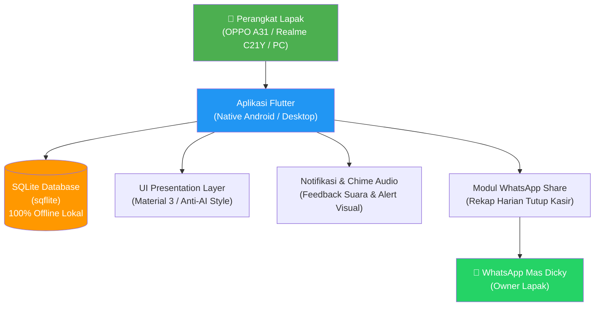
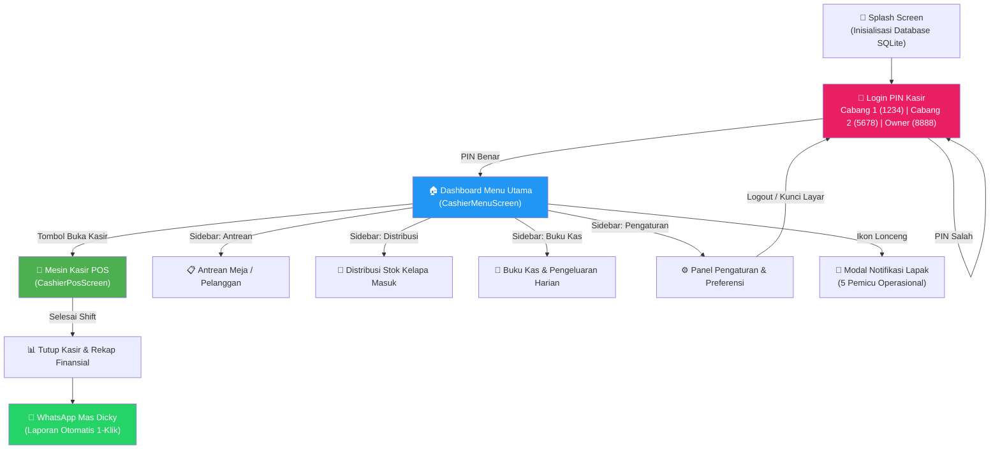
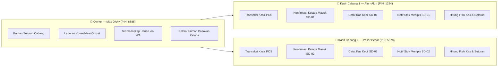
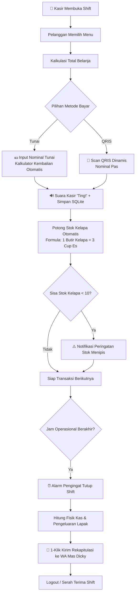
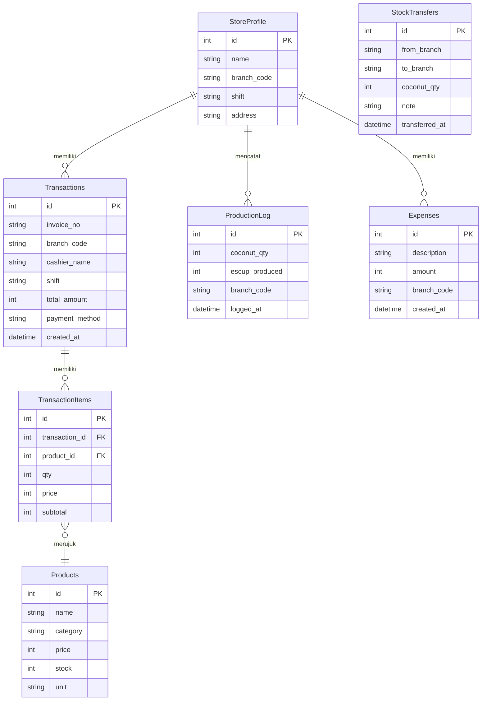

# 🥥 Sarjana Degan POS — Madiun

<p align="center">
  
  
  
  
  
  
</p>

> **Sistem Kasir Pintar (POS) & Manajemen Operasional Lapak Offline-First Berbasis Flutter & SQLite**  
> Didesain khusus untuk operasional cepat multi-cabang usaha es kelapa muda dan kelapa utuh **"Sarjana Degan" Madiun**, ramah sentuhan jempol di perangkat Tablet Android (OPPO A31 / Realme C21Y), Ponsel, serta PC Desktop.

---

## 📋 Daftar Isi
1. [Latar Belakang & Masalah](#-latar-belakang--masalah)
2. [Rancangan Sistem & Arsitektur](#-rancangan-sistem--arsitektur)
   - [Arsitektur Offline-First](#1-arsitektur-aplikasi-offline-first)
   - [Diagram Alur Navigasi Antarmuka](#2-diagram-alur-navigasi-antarmuka)
   - [Diagram Peran Pengguna (User Persona)](#3-diagram-peran-pengguna)
   - [Alur Bisnis Transaksi & Formula Produksi](#4-alur-bisnis-transaksi--formula-kelapa)
3. [Fitur Unggulan](#-fitur-unggulan)
4. [Sistem Notifikasi Lapak (5 Fitur)](#-sistem-notifikasi-lapak-5-fitur)
5. [Skema Database SQLite (7 Tabel)](#-skema-database-sqlite-7-tabel)
6. [Struktur Direktori Proyek](#-struktur-direktori-proyek)
7. [Panduan Instalasi & Menjalankan](#-panduan-instalasi--menjalankan)
8. [Roadmap Pengembangan](#-roadmap-pengembangan)
9. [Hak Cipta & Pengembang](#-hak-cipta--pengembang)

---

## 🎯 Latar Belakang & Masalah

Usaha minuman kelapa muda dan agen kelapa **Sarjana Degan Madiun** mengoperasikan 2 cabang strategis di Kota Madiun:
- **Cabang 1:** Lapak Alun-Alun Madiun (Kode: `SD-01`)
- **Cabang 2:** Lapak Pasar Besar Madiun (Kode: `SD-02`)

Sebelumnya seluruh operasional kasir mengandalkan nota kertas manual dan kalkulator fisik, yang memicu berbagai kendala:
1. **Risiko Selisih Kasir:** Salah hitung kembalian dan total belanja saat jam ramai pembeli.
2. **Stok Kelapa Tidak Terukur:** Bahan baku kelapa utuh sering tidak sinkron dengan es cup yang terjual (formula konversi: **1 butir kelapa = 3 porsi es cup**).
3. **Pengeluaran Lapak Tidak Terpusat:** Pembelian es batu kristal, kantong kresek, dan sedotan sering tercecer dari pembukuan harian.
4. **Koneksi Internet Lapak Fluktuatif:** Lapak pinggir jalan sering mengalami kendala sinyal, sehingga sistem kasir **wajib 100% Offline-First** (tidak boleh terhenti karena masalah jaringan internet).

---

## 🏗️ Rancangan Sistem & Arsitektur

### 1. Arsitektur Aplikasi (Offline-First)

Sistem beroperasi **100% lokal** di perangkat tanpa ketergantungan server cloud. Internet hanya digunakan saat kasir menekan tombol kirim rekapitulasi harian via WhatsApp ke Mas Dicky.



---

### 2. Diagram Alur Navigasi Antarmuka

Alur perjalanan pengguna mulai dari membuka aplikasi, otentikasi PIN, operasional kasir, hingga tutup shift harian:



---

### 3. Diagram Peran Pengguna

Aplikasi membagi wewenang ke dalam 3 entitas pengguna:



---

### 4. Alur Bisnis Transaksi & Formula Kelapa

Siklus hidup transaksi dari pesanan pelanggan hingga mutasi stok bahan baku:



#### 🥥 Formula Konversi Produksi:
> **1 Butir Kelapa Muda Utuh = 3 Porsi Es Cup Degan**  
> Setiap transaksi 3 cup es terjual, sistem otomatis mengurangi 1 stok butir kelapa dari inventaris cabang terkait.

---

## ✨ Fitur Unggulan

### 1. 🔐 Keamanan & Login PIN Multi-Peran
- **Cabang 1 (Alun-Alun):** PIN Kasir `1234`
- **Cabang 2 (Pasar Besar):** PIN Kasir `5678`
- **Owner (Mas Dicky):** PIN Supervisor `8888`
- Proteksi lintas tab cabang otomatis (mencegah salah pilih cabang).
- Pilihan shift operasional: **Shift Pagi (08:00 - 15:00)** & **Shift Sore (15:00 - 22:00)**.
- Jam digital realtime WIB berdetak per detik dengan proteksi *anti-overflow layout*.
- Desain visual *Anti-AI Aesthetic*: Header foto kelapa muda berembun asli dengan teknik *dual-layer drop shadow*.

### 2. 🏠 Dashboard Menu Beranda (`CashierMenuScreen`)
- Terinspirasi dari antarmuka modern *Chili POS*:
  - **Sidebar Navigasi Kiri:** Menu Utama, Antrean Meja, Distribusi Kelapa, Buku Kas, Pengaturan.
  - **Top Bar Multifungsi:** Kolom pencarian menu, jam realtime, tombol Contoh Struk Nota, dan lonceng notifikasi lapak.
  - **Kartu Kategori Melengkung:** Filter instan `Semua`, `Kelapa Murni`, `Es Cup`, `Paket`, dan `Promo`.
  - **Bottom Status Bar:** Pemantau status shift aktif, estimasi sisa stok kelapa, dan ringkasan kas fisik harian.
  - **Tombol Aksi Utama:** Tombol hijau elegan untuk membuka mesin kasir POS.

### 3. 🛒 Mesin Kasir POS Split-Screen (`CashierPosScreen`)
- **Panel Kiri (Katalog Menu Cepat):**
  - Kartu produk ramah sentuhan jempol dengan badge harga Emerald Green (`#059669`) dan stok sisa real-time.
  - Pencarian nama menu instan dan filter kategori.
- **Panel Kanan (Struk Belanja Interaktif):**
  - Stepper tombol kuantitas `[-]` `[Qty]` `[+]`.
  - Subtotal per item terhitung otomatis seketika.
  - Tombol kosongkan keranjang & hapus per baris pesanan.
  - Total belanja kontras tinggi dan tombol besar **`BAYAR`**.
- **Modal Pembayaran Cepat (Quick Pay):**
  - Tab pilihan pembayaran **Tunai** vs **QRIS**.
  - Tombol pecahan cepat: *Uang Pas, Rp 10.000, Rp 20.000, Rp 50.000, Rp 100.000*, serta input angka manual.
  - Kalkulator kembalian otomatis: indikator hijau jika pas/lebih, indikator merah & proteksi tombol terkunci jika uang bayar kurang.
- **Format Nota Invoice Unik Per Cabang:**
  - Cabang 1: `TRX-SD01-YYYYMMDD-001`
  - Cabang 2: `TRX-SD02-YYYYMMDD-001`

### 4. ⚙️ Panel Pengaturan & Keamanan Kasir
- Bottom sheet pengaturan ringkas:
  - Informasi cabang aktif & sesi shift yang bertugas.
  - Tombol **Logout / Kunci Layar** warna merah dengan dialog konfirmasi aman untuk mencegah ketidaksengajaan keluar sistem.

---

## 🔔 Sistem Notifikasi Lapak (5 Fitur)

Aplikasi dilengkapi modal pengaturan dan pemicu notifikasi terpadu untuk kebutuhan operasional lapak:

| No | Jenis Notifikasi | Kondisi Pemicu | Kegunaan Lapak |
|:---:|---|---|---|
| 1 | ⚠️ **Peringatan Stok Menipis** | Sisa stok kelapa butir di bawah 10 butir | Mengingatkan kasir agar segera meminta pasokan kelapa tambahan ke Mas Dicky |
| 2 | ⏰ **Pengingat Tutup Shift** | Jam operasional shift berakhir (15:00 / 22:00 WIB) | Memandu kasir menghitung uang fisik di laci dan menyiapkan setoran |
| 3 | 📦 **Pemberitahuan Kelapa Masuk** | Pasokan kelapa baru dikirim Mas Dicky ke cabang | Mengarahkan kasir memeriksa fisik kelapa dan konfirmasi penerimaan stok |
| 4 | 📋 **Notifikasi Pesanan Admin** | Pesanan baru masuk dari pesanan titipan/admin | Kasir dapat segera menyiapkan pesanan sebelum diambil kurir/pelanggan |
| 5 | 🔊 **Suara Kasir (Chime)** | Setiap pembayaran transaksi berhasil diverifikasi | Memberikan nada konfirmasi audio *"Ting!"* yang melegakan dan profesional |

---

## 🗄️ Skema Database SQLite (7 Tabel)

Database lokal menggunakan SQLite (`database_helper.dart`) dengan 7 tabel utama:



---

## 📁 Struktur Direktori Proyek

```text
kasir_pos/
├── android/                     # Konfigurasi Native Android (Gradle, Manifest)
├── assets/                      # Aset gambar asli & ikon pendukung
├── lib/
│   ├── assets/
│   │   └── coconut_image.dart   # Embed bytes foto kelapa asli (resolusi tinggi)
│   ├── database/
│   │   └── database_helper.dart # Helper SQLite, auto-migration, seed produk
│   ├── models/
│   │   ├── product.dart         # Model entitas produk & stok
│   │   ├── transaction_model.dart # Model transaksi & invoice
│   │   ├── transaction_item.dart  # Model rincian item nota
│   │   ├── production_log.dart  # Model konversi kelapa -> es cup (1:3)
│   │   ├── expense.dart         # Model pengeluaran operasional
│   │   └── store_profile.dart   # Model profil identitas cabang
│   ├── screens/
│   │   ├── cashier_menu_screen.dart # Dashboard Beranda Utama (Chili POS style)
│   │   └── cashier_pos_screen.dart  # Layar Mesin Kasir POS Transaksi
│   └── main.dart                # Entrypoint aplikasi & Layar Login PIN 3 Peran
├── test/                        # Pengujian unit logic & widget
├── catatan.md                   # Log progress harian & rencana kerja
├── prd.md                       # Product Requirements Document resmi
├── revisi.md                    # Roadmap teknis implementasi bertahap
├── serve_lan.dart               # Server HTTP LAN port 8181
└── pubspec.yaml                 # Dependensi Flutter & metadata
```

---

## 🚀 Panduan Instalasi & Menjalankan

### Persyaratan Lingkungan:
- **Flutter SDK:** v3.24.5 (Dart 3.5.4)
- **Android Studio:** 2026.2.2.9 + Android SDK Platform (API 30+)
- **Perangkat Target:** Ponsel/Tablet Android (USB Debugging aktif) atau Browser Chrome/Edge

### 1. Menjalankan Langsung ke Perangkat Android Fisik (Rekomendasi Utama):
```powershell
# Hubungkan kabel USB ponsel/tablet (misal: OPPO A31)
cd c:\proyek\kasir_pos

# Cek device terdeteksi
C:\platform-tools\adb.exe devices

# Jalankan aplikasi (Hot Reload aktif dengan menekan tombol 'r' di terminal)
D:\flutter\bin\flutter.bat run -d IZV8V4FIP7SOPVWK
```

### 2. Menjalankan via Local Web Server LAN (Port 8181):
```powershell
cd c:\proyek\kasir_pos
D:\flutter\bin\flutter.bat run -d web-server --web-port 8181 --web-hostname 0.0.0.0
```
- Akses di PC: `http://localhost:8181`
- Akses di Tablet/HP (dalam satu Wi-Fi): `http://192.168.1.13:8181`

---

## 🗺️ Roadmap Pengembangan

- [x] **Fase 1: Fondasi & Database** (Login PIN 3 Peran, SQLite 6 Tabel, Seed Produk Awal)
- [x] **Fase 2: Layar Transaksi POS** (Katalog produk, keranjang interaktif, split-screen)
- [x] **Fase 3: Pembayaran & Invoice** (Quick pay, kalkulator kembalian, struk nota digital)
- [x] **Fase 4: Dashboard Menu Chili POS** (Sidebar, top search bar, kartu kategori, panel pengaturan & notifikasi)
- [ ] **Fase 5: Operasional Lapak Lengkap** (Distribusi stok kelapa fisik, form pengeluaran kas kecil)
- [ ] **Fase 6: Rekapan Harian & Integrasi WhatsApp** (Layar tutup kasir, hitung setoran fisik, 1-klik kirim rekap ke WA Mas Dicky)

---

## 👥 Hak Cipta & Pengembang

- **Pemilik Usaha:** Mas Dicky — *Sarjana Degan Madiun*
- **Sistem Arsitek & Lead Mentor:** ZettBOT by Zettbos
- **Repositori Resmi:** [github.com/masdic/kasir-project-sarjanadegaanmdn](https://github.com/masdic/kasir-project-sarjanadegaanmdn)
